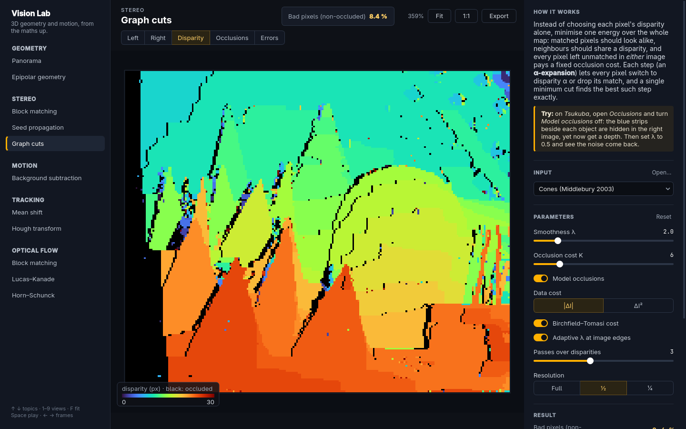
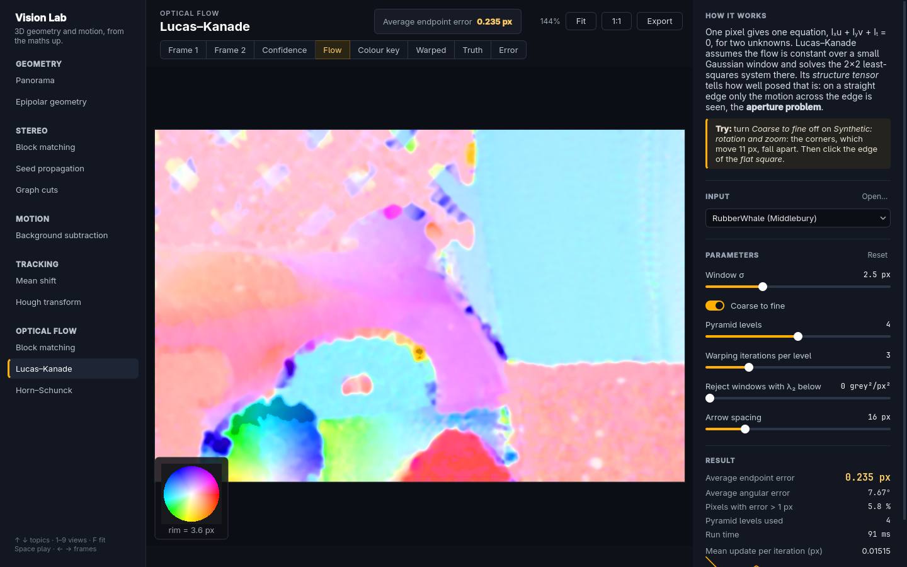

# Vision Lab: 3D geometry and motion, from the maths up

[](.github/workflows/build.yml)


**A desktop app that lets you watch the classic methods of 3D and motion vision work, step by step, on real benchmark images.**
Eleven topics, from panoramas and epipolar lines to Kolmogorov–Zabih graph cuts, background subtraction, tracking and optical flow. Each method is written by hand in C++20, tested against ground truth, and shown with its insides: the matches RANSAC kept, the energy of every graph-cut move, the weights mean shift climbs, the confidence of Lucas–Kanade at each pixel.

On the Middlebury *Tsukuba* pair, my graph-cut stereo leaves **3.7 % bad pixels where block matching leaves 22.9 %**, in about half a second.



## Why I built it

These methods are usually met as slides and a lab notebook: you call a function, you get a picture, and the mechanism stays hidden. I wanted the opposite. Every topic shows the intermediate state that *is* the algorithm, lets you change one parameter, and answers within a fraction of a second, so you can see why it works and where it breaks.

The topics follow a master's course on 3D vision and motion analysis: projective geometry and panoramas, the fundamental matrix and RANSAC, local and global disparity estimation (correlation, seeds, max-flow and graph cuts), motion detection, visual tracking, and optical flow. The repository started in 2019 as a small Qt/OpenCV MVC exercise; the architecture idea stayed, everything else was rebuilt.

## What you can do in it

| Topic | What you see move | Measured on its samples |
|---|---|---|
| Panorama | SIFT matches, RANSAC inliers (green) and outliers (red), the warped images and their seams | Graffiti 1→3: corners within **1.25 px** of the true homography |
| Epipolar geometry | Click a point, get its epipolar line in the other view; the epipoles | Synthetic room: **0.11 px** from the true F. Merton College: 916 of 1017 matches kept |
| Block matching | SAD / SSD / ZNCC disparity, the left-right check, a pixel's search row | Tsukuba 22.9 %, Cones 11.6 % bad pixels |
| Seed propagation | Confident seeds, then the region growing in order of arrival | Tsukuba 11.1 %, Cones 10.0 % |
| Graph cuts | Kolmogorov–Zabih energy falling move by move; occlusions found | Tsukuba **3.7 %**, Cones 8.4 %, synthetic 1.4 % |
| Background subtraction | Mean, median, Σ-Δ and Gaussian models; morphology or an MRF cleaning the mask | Synthetic clip: F1 **0.998** |
| Mean shift | The hue back-projection and the box climbing it; a Kalman prediction | Disc behind a pillar: IoU 0.42 → **0.86** with Kalman |
| Hough transform | The R-table votes and their peak, frame by frame | Synthetic clip: IoU 1.00 |
| Optical flow ×3 | Block matching, Lucas–Kanade (with its confidence map) and Horn–Schunck | RubberWhale endpoint error: LK **0.235 px**, HS 0.341, BM 0.355 |

Bad pixels are pixels visible in both views whose disparity is off by more than one pixel. Graph cuts run at half resolution by default; the other stereo numbers are at full resolution. Every number above comes from `vision-lab --module <topic> --sample <n> --stats` on this repository.

| | | |
|---|---|---|
|  |  |  |
|  |  | |

## A worked example: why graph cuts beat a window

Block matching decides each pixel alone: it slides a 7×7 window along the row of the other image and keeps the most similar shift. Two things defeat it. Inside a flat region every shift looks alike, and near a depth edge the window straddles two surfaces. On Tsukuba that is 22.9 % of the visible pixels.

Graph cuts decide all pixels together. Each match pays for how different the two pixels look; two neighbours with different disparities pay a smoothness penalty λ; and a pixel left without a partner pays a fixed occlusion cost K, so occlusions are modelled instead of guessed. Kolmogorov and Zabih (ICCV 2001) showed how to lower that energy exactly one *α-expansion* at a time: every pixel may switch to disparity α or keep its match, and one minimum cut on a graph with about two nodes per pixel picks the best switch. With λ = 2 and K = 6, three passes over the disparities make 33 moves on Tsukuba and leave 3.7 % bad pixels, with occlusions explicitly marked. The graph is cut by my implementation of the Boykov–Kolmogorov max-flow algorithm, tested against brute force on 400 random graphs.

The idea I rejected was to smooth block matching afterwards (median filter, bigger windows): it trades noise for fattened edges, and it cannot tell an occlusion from a bad match.

## Run it

You need CMake ≥ 3.24, a C++20 compiler, Qt 6 (Widgets, Concurrent), OpenCV ≥ 4.5 and GoogleTest (downloaded if missing).

```bash
# Arch:   sudo pacman -S cmake ninja qt6-base opencv gtest
# Ubuntu: sudo apt install cmake ninja-build qt6-base-dev libopencv-dev libgtest-dev
cmake --preset release
cmake --build --preset release
ctest --preset release              # 92 unit tests
scripts/fetch_data.sh               # optional, ~60 MB of public benchmarks into data/
build/release/vision-lab
```

Every topic opens on a synthetic scene with exact ground truth, so the app is useful before any download. `fetch_data.sh` adds the Middlebury stereo and optical-flow pairs, the Oxford Graffiti and Merton College images, OpenCV's panorama photos and the tracking test videos; `data/SOURCES.md` cites each one. You can also open your own images or videos (Ctrl+O).

Keys: ↑ ↓ topics, 1–9 views, F fit, Space play, ← → frames, Ctrl+E export the picture with its overlays.

For scripts and CI, the app runs headless:

```bash
QT_QPA_PLATFORM=offscreen build/release/vision-lab --list
QT_QPA_PLATFORM=offscreen build/release/vision-lab --module stereo-graphcut --sample 1 --stats
QT_QPA_PLATFORM=offscreen build/release/vision-lab --module epipolar --sample 1 --click 300,200 \
    --screenshot out.png --size 1440x900
```

## How it is built


```
src/core/      the algorithms, C++20 + OpenCV only (no Qt), one static library per area
  common/        synthetic scenes with ground truth, task cancellation, image helpers
  geometry/      DLT, RANSAC, 8-point F, SIFT matching, stitching
  stereo/        block matching, seeds, Boykov–Kolmogorov max-flow, Kolmogorov–Zabih graph cuts
  motion/        background models, ICM, mean shift, generalised Hough, Kalman
  flow/          block matching, Lucas–Kanade, Horn–Schunck, colour coding, .flo, EPE
src/app/       Qt 6 Widgets: model (Document), controller (AppController, Runner), view
  modules/       one file per topic: what it needs, its parameters, compute(), its pictures
tests/         GoogleTest per area, against ground truth and OpenCV references
scripts/       fetch_data.sh
```

- **Model / view / controller.** A topic is a pure description plus a pure `compute()`: it never touches a widget. The framework builds the inspector from its parameter list, runs it, and draws its pictures and vector overlays.
- **Responsive by construction.** A slider move becomes one run after 120 ms of quiet; a newer request cancels the running one through a `std::stop_token`, and stale results are dropped. Long methods stream partial results, so you watch Horn–Schunck converge or the graph cut improve move by move.
- **Written by hand where it matters.** OpenCV does I/O, colour conversion, SIFT detection and display warps. RANSAC, DLT, the 8-point algorithm, max-flow, α-expansion, the background models, ICM, mean shift, the Hough tracker, Kalman, Lucas–Kanade and Horn–Schunck are mine; OpenCV's versions appear only in tests, as references.
- **Tests that catch real bugs.** Each area was checked by reintroducing realistic mistakes (a reversed search direction, a de-normalisation without the transpose, a dropped occlusion term, an unscaled pyramid flow) and confirming a test fails.

## Limits

- Graph cuts on a full-resolution Cones pair take about 20 s; the default half resolution takes 2 s. There is no "stop and keep the current result" button yet.
- With integer disparities, Kolmogorov–Zabih's uniqueness constraint leaves a one-pixel occluded column at each disparity step of a slanted surface; Potts graph cuts do better on the synthetic slanted wall, Kolmogorov–Zabih clearly better where real occlusions matter (Cones).
- Multi-view stereo and learning-based flow and depth are not covered.
- The CI builds on Ubuntu 24.04 (Qt 6.4, OpenCV 4.6); development happens on Qt 6.11 and OpenCV 5.0.

## Learn the theory

Each topic has a long-form lesson in my notes, the eleven-part course "3D Vision and Motion": cameras and projective geometry, homographies and panoramas, SIFT, RANSAC, epipolar geometry, local disparity, max-flow and min-cut, α-expansion and Kolmogorov–Zabih, background subtraction, tracking, and optical flow, every formula derived from scratch. The app is the lab; the series is the course.

## License

MIT. The benchmark datasets downloaded by `scripts/fetch_data.sh` keep their own terms; see `data/SOURCES.md`.
