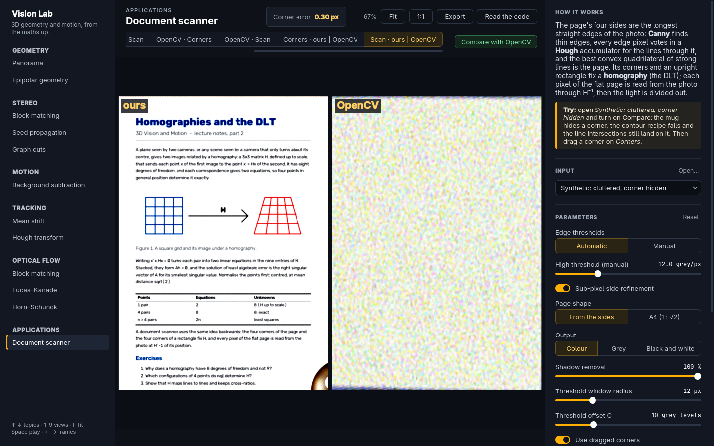
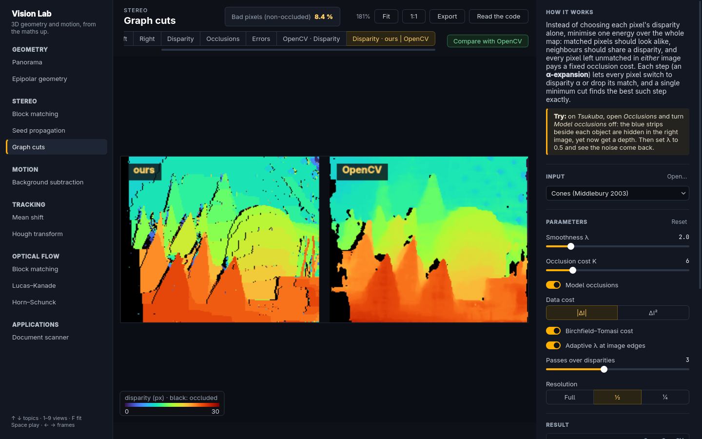
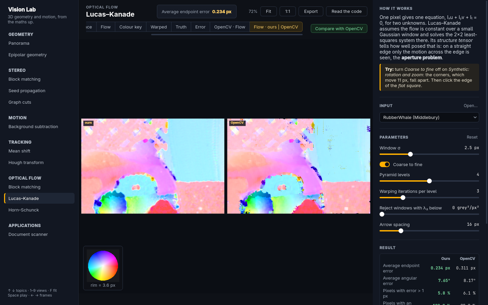
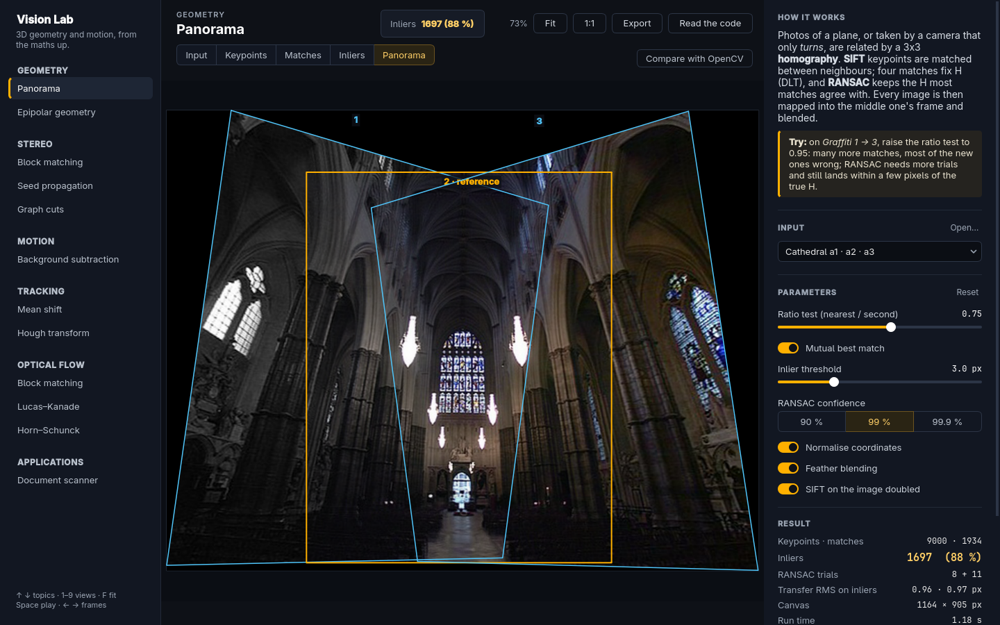
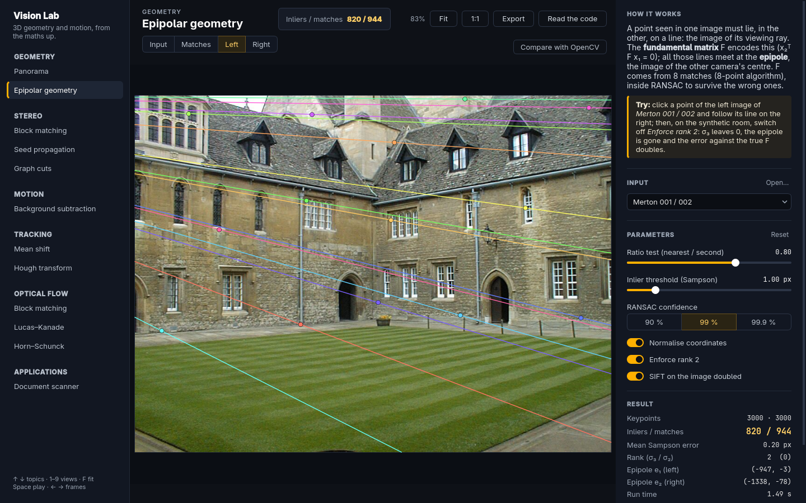
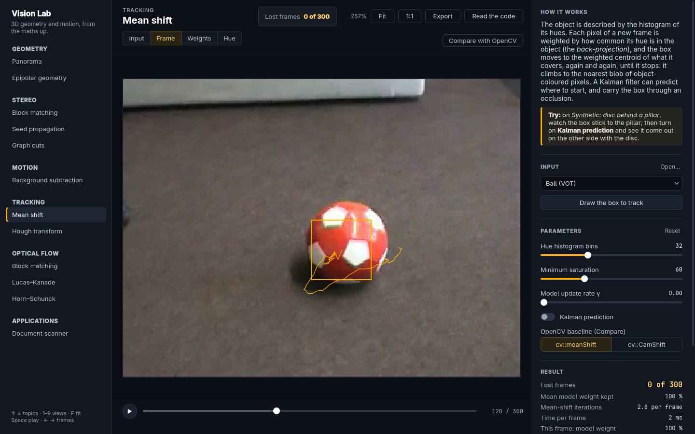
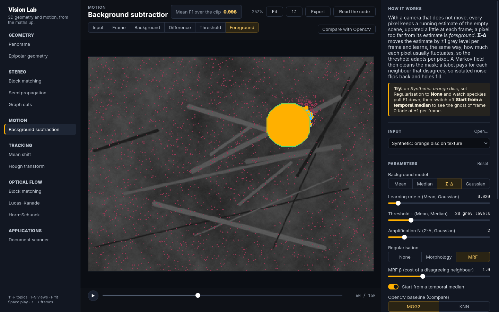
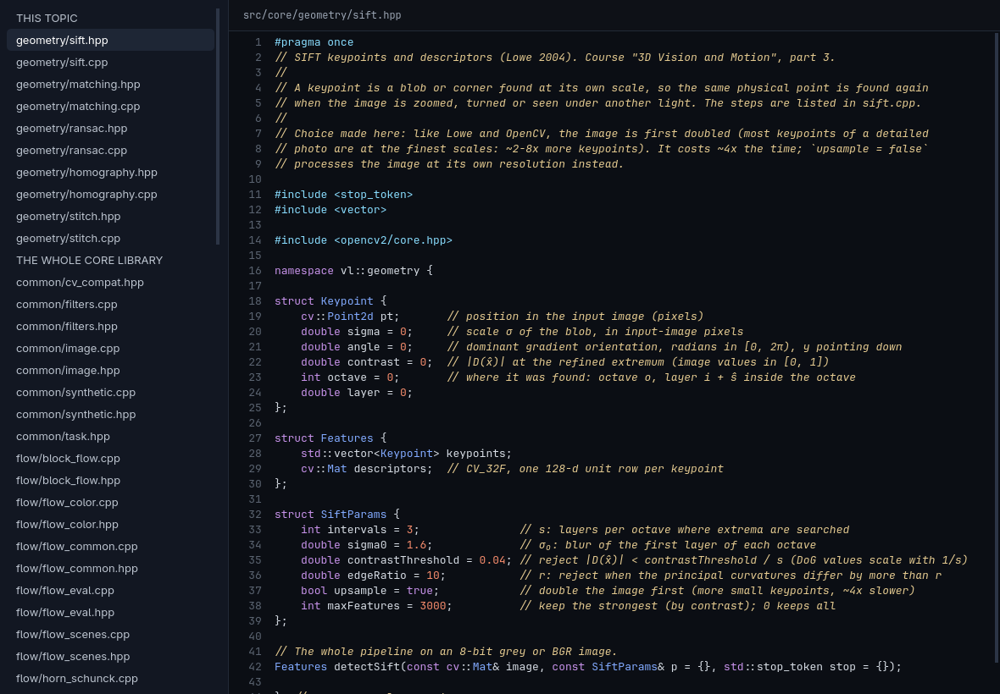
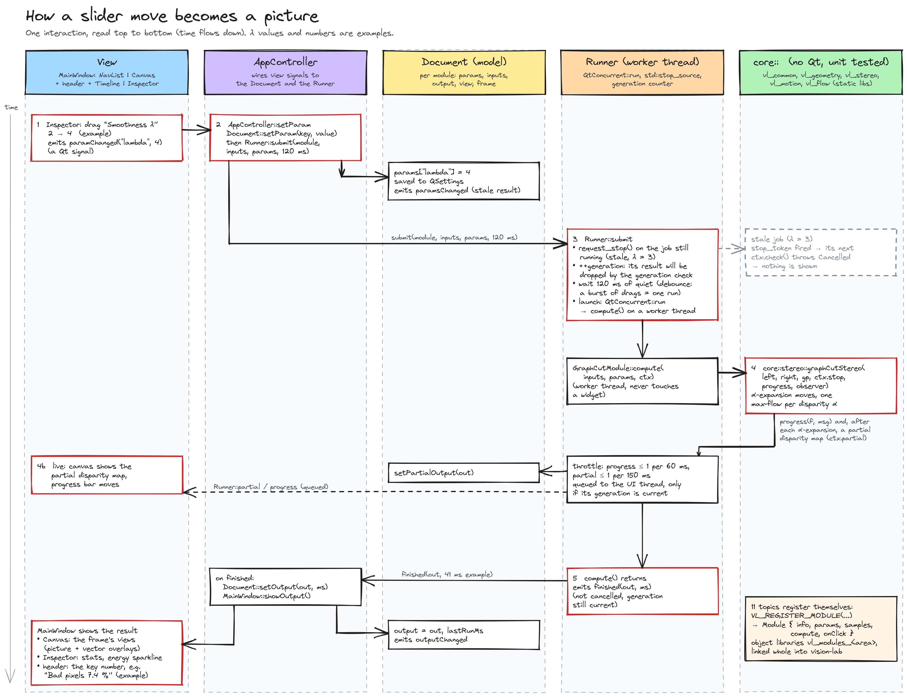

# Vision Lab: 3D geometry and motion, from the maths up

[](.github/workflows/build.yml)


**A desktop lab where the classic methods of 3D and motion vision are written from scratch, shown working step by step, and measured against OpenCV on the same images.**
Twelve topics, from panoramas and epipolar lines to Kolmogorov–Zabih graph cuts, background subtraction, tracking, optical flow and a CamScanner-like document scanner. SIFT, RANSAC, the DLT, max-flow, α-expansion, mean shift, the Kalman filter, Lucas–Kanade and Horn–Schunck are mine, in plain readable C++20 a master's student can follow; OpenCV is the baseline you can switch on next to them.

On a photo where a mug hides one corner of the page, my scanner finds the corners within **0.3 px**; the classic OpenCV recipe (contours, `approxPolyDP`) locks onto a sticky note instead.



## Why I built it

These methods are usually met as slides and a call to `cv::something`: you get a picture, and the mechanism stays hidden. I wanted the opposite. Every topic opens on the clean input, then shows the intermediate state that *is* the algorithm (the matches RANSAC kept, the votes of a Hough transform, the energy after each graph-cut move, the confidence of Lucas–Kanade at each pixel), lets you change one parameter, and answers in a fraction of a second.

Writing them myself was the point, so the app also shows the code: **Read the code** (Ctrl+K) opens the topic's source next to its picture, and **Compare with OpenCV** runs OpenCV's own method on the same input, puts both results side by side and scores them. Sometimes mine wins, sometimes OpenCV does, and the app says which.

The topics follow a master's course on 3D vision and motion analysis: projective geometry and panoramas, the fundamental matrix and RANSAC, local and global disparity estimation, motion detection, visual tracking and optical flow. The repository started in 2019 as a small Qt/OpenCV MVC exercise; the architecture idea stayed, everything else was rebuilt.

## Ours vs OpenCV, on the same input

| Topic | Measured on | Ours | OpenCV baseline |
|---|---|---|---|
| Panorama: SIFT, matching, RANSAC, DLT | Graffiti 1→3, corner error vs true H | 4.36 px | cv::SIFT + BFMatcher + findHomography: 4.15 px |
| Epipolar geometry: 8-point in RANSAC | synthetic room, error vs true F | **0.08 px** | findFundamentalMat: 0.39 px |
| Block matching: ZNCC, integral images | Tsukuba, bad pixels | 22.9 % | StereoBM: 23.0 % |
| Seed propagation | Tsukuba, bad pixels | 11.1 % | StereoSGBM: **4.1 %** |
| Graph cuts: Kolmogorov–Zabih α-expansion | Tsukuba / Cones, bad pixels | **3.8 %** / 8.4 % | StereoSGBM: 4.3 % / **5.6 %** |
| Background subtraction: Σ-Δ + MRF | synthetic clip, mean F1 | **0.998** | MOG2: 0.935 |
| Mean shift + Kalman | disc behind a pillar, mean IoU | **0.856** | cv::meanShift: 0.399 |
| Hough tracking + Kalman | same clip, mean IoU | **0.982** | GeneralizedHoughBallard: 0.769 |
| Lucas–Kanade, coarse to fine | RubberWhale, endpoint error | **0.234 px** | calcOpticalFlowPyrLK: 0.311 px |
| Horn–Schunck, coarse to fine | RubberWhale, endpoint error | **0.298 px** | Farneback: 0.361 px |
| Block-matching flow | RubberWhale, endpoint error | 0.354 px | DISOpticalFlow: **0.225 px** |
| Document scanner: Canny, Hough, DLT | cluttered photo, corner error | **0.30 px** | contours + approxPolyDP: wrong page |

OpenCV is faster on most topics, often 5 to 100 times: it is SIMD-optimised C++, mine is plain loops written to be read. Lucas–Kanade is the exception: `calcOpticalFlowPyrLK` run on every pixel is slower than my dense version on most samples. Bad pixels are pixels visible in both views whose disparity is off by more than one pixel; graph cuts run at half resolution by default (0.36 s on Tsukuba, 1.3 s on Cones). Every number above comes from `vision-lab --module <topic> --sample <n> --compare --stats` on this repository.

| | |
|---|---|
|  |  |
|  |  |
|  |  |

## Readable on purpose



Every method follows the same layout: a header that names the method, the part of the course that teaches it and its steps, then one function per step, named after the step, with the equation it implements written above it in the course's notation. SIFT reads `buildScaleSpace → findExtrema → refineExtremum → assignOrientation → describe`; Boykov–Kolmogorov max-flow reads `grow → augment → adopt`; the Kolmogorov–Zabih move graph writes each energy term as its 2×2 table and says why it is regular. Plain `for y … for x` loops, no pointer tricks; the efficiency the methods teach (integral images, separable filters, pyramids, search trees) is kept, because it is part of the method.

OpenCV is used only for image I/O, colour conversion, small SVDs, drawing and the baselines in `opencv_baselines.*`. Blur, Sobel, morphology, pyramids, warping, histograms, feature matching and SIFT itself are written in `src/core`, and tested against OpenCV's versions.

## A worked example: why graph cuts beat a window

Block matching decides each pixel alone: it slides a 7×7 window along the row of the other image and keeps the most similar shift. Two things defeat it: inside a flat region every shift looks alike, and near a depth edge the window straddles two surfaces. On Tsukuba that is 22.9 % of the visible pixels.

Graph cuts decide all pixels together. Each match pays for how different the two pixels look; two neighbours with different disparities pay a smoothness penalty λ; a pixel left without a partner pays a fixed occlusion cost K, so occlusions are modelled instead of guessed. Kolmogorov and Zabih (ICCV 2001) showed how to lower that energy exactly one *α-expansion* at a time: every pixel may switch to disparity α or keep its match, and one minimum cut picks the best switch. With λ = 2 and K = 6, three passes make 33 moves on Tsukuba and leave 3.8 % bad pixels, with the occluded pixels marked rather than guessed. SGBM's semi-global smoothing gets 4.3 % there and is far faster; on Cones it wins (5.6 % against 8.4 %), which the app shows just as plainly.

## Run it

You need CMake ≥ 3.24, a C++20 compiler, Qt 6 (Widgets, Concurrent), OpenCV ≥ 4.5 and GoogleTest (downloaded if missing).

```bash
# Arch:   sudo pacman -S cmake ninja qt6-base opencv gtest
# Ubuntu: sudo apt install cmake ninja-build qt6-base-dev libopencv-dev libgtest-dev
cmake --preset release
cmake --build --preset release
ctest --preset release              # 127 unit tests
scripts/fetch_data.sh               # optional, ~60 MB of public benchmarks into data/
build/release/vision-lab
```

Every topic opens on a synthetic scene with exact ground truth, so the app is useful before any download. `fetch_data.sh` adds the Middlebury stereo and optical-flow pairs, the Oxford Graffiti and Merton College images, OpenCV's panorama photos and the tracking test videos; `data/SOURCES.md` cites each one. You can also open your own images, videos or document photos (Ctrl+O), and drag the scanner's corners.

Keys: ↑ ↓ topics, 1–9 views, F fit, Space play, ← → frames, Ctrl+K read the code, Ctrl+E export the picture with its overlays.

For scripts and CI, the app runs headless:

```bash
QT_QPA_PLATFORM=offscreen build/release/vision-lab --list
QT_QPA_PLATFORM=offscreen build/release/vision-lab --module stereo-graphcut --sample 1 --compare --stats
QT_QPA_PLATFORM=offscreen build/release/vision-lab --module doc-scanner --sample 4 --compare \
    --view "Scan · ours | OpenCV" --screenshot out.png --size 1440x900
```

## How it is built



```
src/core/      the methods, C++20 + OpenCV containers only (no Qt), one static library per area
  common/        filters (Gaussian, Sobel, morphology, pyramids), synthetic scenes with ground truth
  geometry/      SIFT, matching, RANSAC, DLT, 8-point F, stitching
  stereo/        block matching, seeds, Boykov–Kolmogorov max-flow, Kolmogorov–Zabih graph cuts
  motion/        background models, ICM, mean shift, generalised Hough, Kalman
  flow/          block matching, Lucas–Kanade, Horn–Schunck, colour coding, .flo, EPE
  scanner/       Canny, Hough lines, page quadrilateral, rectification, illumination and threshold
  */opencv_baselines.*   OpenCV's methods, run on the same input for the comparison
src/app/       Qt 6 Widgets: model (Document), controller (AppController, Runner), view
  modules/       one file per topic: what it needs, its parameters, compute(), its pictures
tests/         GoogleTest per area, against ground truth and OpenCV
scripts/       fetch_data.sh
```

- **Model / view / controller.** A topic is a pure description plus a pure `compute()`: it never touches a widget. The framework builds the inspector from its parameter list, runs it, draws its pictures and vector overlays, adds the clean Input view first and the side-by-side splits when comparing.
- **Responsive by construction.** A slider move becomes one run after 120 ms of quiet; a newer request cancels the running one through a `std::stop_token`, and stale results are dropped. Long methods stream partial results, so you watch Horn–Schunck converge or the graph cut improve move by move; video plays without rebuilding a widget per frame.
- **Tests that catch real bugs.** Each area was checked by reintroducing realistic mistakes (a Newton step with the wrong sign in SIFT, a missing transpose when de-normalising F, a dropped occlusion term, an unscaled pyramid flow, a window one column short in the scanner's threshold) and confirming a test fails; every test has a timeout, so a looping max-flow fails instead of hanging.

## Limits

- Plain loops are slower than OpenCV: SIFT on a 640×480 photo takes about half a second, and full-resolution graph cuts on Cones about 12 s (half resolution, the default, 1.3 s).
- On Graffiti 1→3 my SIFT lets about 40 false matches through RANSAC, which costs 4.36 px of corner error where OpenCV's pipeline gets 4.15 px.
- With integer disparities, Kolmogorov–Zabih's uniqueness constraint leaves one-pixel occluded columns on slanted surfaces; SGBM is better on Cones.
- Multi-view stereo and learning-based flow and depth are not covered.
- CI builds on Ubuntu 24.04 (Qt 6.4, OpenCV 4.6); development happens on Qt 6.11 and OpenCV 5.0.

## Learn the theory

Four courses in my notes go with this repository, every formula derived from scratch:
- **3D Vision and Motion** (11 parts): cameras, homographies and panoramas, SIFT, RANSAC, epipolar geometry, local disparity, max-flow, α-expansion and Kolmogorov–Zabih, background subtraction, tracking, optical flow; each part ends with the functions to read in this code.
- **Mathematics for Computer Vision** (10 parts): vectors and rotations, least squares, eigenvalues and the SVD, multivariable calculus, optimisation, calculus of variations, probability, Kalman and particle filters, Markov random fields.
- **Qt 6 Desktop Apps** (8 parts): the meta-object system, signals and the event loop, layouts, style sheets, the Graphics View framework, MVC, concurrency without freezing the UI, building and shipping, all dissected from this app.
- **Building a document scanner from scratch**: the scanner topic, step by step.

## License

MIT. The benchmark datasets downloaded by `scripts/fetch_data.sh` keep their own terms; see `data/SOURCES.md`.
